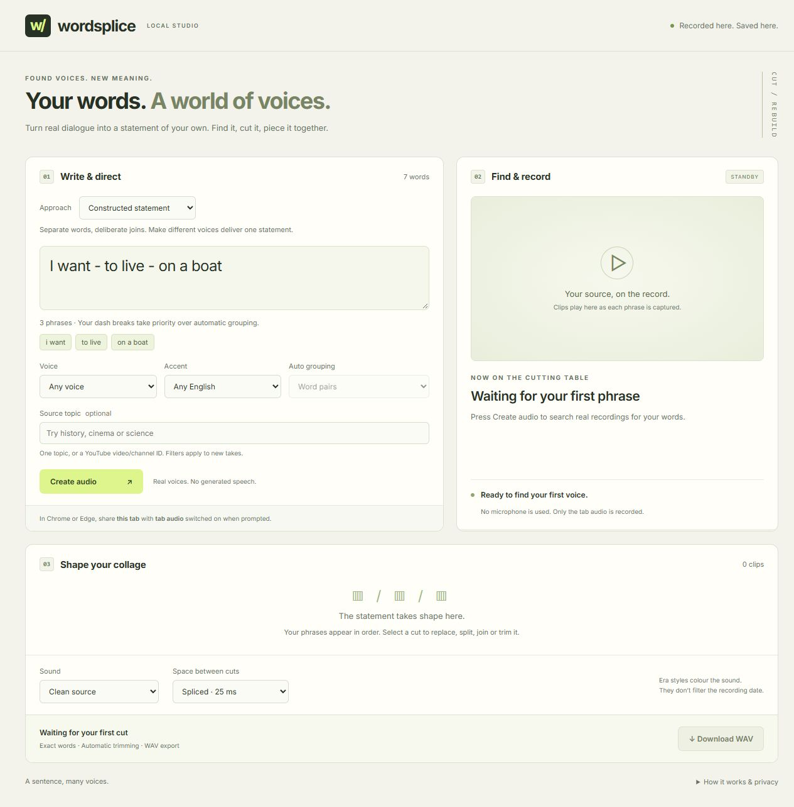

# Wordsplice

**Your words. A world of voices.**

A local audio collage studio. Write a sentence, find real dialogue through YouGlish, capture the source clips in your browser, and assemble them into a new statement. No generated speech or API key required.



*The studio before recording, with three explicitly separated phrases.*

## Quick start · Windows

You need **Python 3.10 or newer**, **Chrome or Edge**, and an internet connection. Windows is the primary supported environment. Node.js is only needed to run the JavaScript tests.

1. [Download the repository](https://github.com/diamond-one/Wordsplice/archive/refs/heads/main.zip) and extract it, or clone it:
   ```powershell
   git clone https://github.com/diamond-one/Wordsplice.git
   cd Wordsplice
   ```
2. Double-click **Start Wordsplice.cmd**.
3. The launcher installs dependencies into `.venv`, starts the local server, and opens **http://127.0.0.1:8765**. On the first run, allow a few minutes for the approximately 150 MB English speech model to download. Wait for “Ready to find your first voice.”
4. Write a short sentence and choose **Create audio**. In the browser sharing dialog, select **this Wordsplice tab** and enable **Share tab audio**.
5. Keep the tab open as sources play. When the collage is ready, listen, edit, and **Download WAV**.

Keep the setup window open until it says **Audio libraries are ready**. During installation it reports progress periodically and saves detailed output to `data/setup.log`. If setup is interrupted, run the launcher again: it resumes dependency installation and verifies the audio libraries before starting the server. Setup does not delete saved recordings.

The app needs browser tab-audio capture. Use Chrome or Edge for recording; an embedded preview may display the studio without supporting capture. No separate FFmpeg installation is required: audio decoding uses PyAV.

## From sentence to collage

### Set your phrases

Use a dash with spaces on both sides to choose the boundaries:

```text
I want - to live - on a boat
```

This searches for three recordings: **I want**, **to live**, and **on a boat**. Explicit breaks take priority over automatic grouping. If a phrase is unavailable, the app keeps your breaks and flags that phrase.

Without dashes, **Auto grouping** controls the longest phrase to try. Unavailable phrases fall back to shorter phrases and individual words. Write 1–60 English words, spell out numbers, and check spelling: Wordsplice keeps the words you entered.

### Direct the source material

| Control | What it does |
| --- | --- |
| **Constructed statement** | Starts with word pairs and tight 25 ms joins, building a statement from separate voices. |
| **Narrative collage** | Starts with longer dialogue fragments and 150 ms pauses, preserving more of each speaker’s delivery. |
| **Voice** | Any, Male, or Female, using YouGlish’s source labels. |
| **Accent** | Any English, American, British, or Australian. |
| **Source topic** | Narrows searches by context, such as `history`, `cinema`, or `science`. A YouTube video/channel ID can target a particular source. |

Voice, accent, and topic apply to **new recordings**, including replacement, split, and join searches. They do not transform existing voices. The app does not silently drop a voice or topic filter when nothing matches; broaden the filter and retry.

Enter one topic. A leading `#` is optional; spaces are removed (`science fiction` becomes `sciencefiction`). Availability depends on YouGlish’s indexed sources.

### Edit a phrase

Select a cut in the collage to open its editor.

| Action | Result |
| --- | --- |
| **Find another take** | Records the same words from a different source, excluding that phrase’s previously used takes. |
| **Split into two takes** | Choose a word boundary; the app finds and records each half separately. |
| **Join with next** | Finds one continuous recording containing the selected phrase and the following phrase. |
| **In / Out** | Adjusts the cut boundaries within its recording, in seconds. |
| **Pause after** | Sets the silence following this cut, in milliseconds. |
| **Audition cut** | Plays the trimmed source audio before mix effects. |
| **Download this cut** | Exports that trimmed phrase with the selected sound style. |
| **Undo edit** | Restores the previous replacement, split, or join. Up to 20 edits are kept until the page reloads. |

New takes require tab sharing again. A replacement is committed only after all required recordings succeed. Cancelling or failing a split/join preserves the original cuts. Split and join also update the sentence’s dash markers, and rebuild a completed mix automatically.

After changing trims, sound, or spacing, choose **Update mix** to hear and save the changes. The global spacing control resets all per-cut pauses. Download WAV exports the full mix as **48 kHz mono PCM audio**; split cuts can also be downloaded individually.

### Shape the sound

Choose Clean source, Warm sampler, Narrow-band dialogue, or an era-inspired effect:

- **1940s-inspired radio:** narrow bandwidth and saturation.
- **1970s-inspired tape:** soft saturation and subtle pitch drift.
- **1990s-inspired sampler:** reduced sample and bit resolution.

These presets change the sound; **they do not filter the original recording date** or claim to emulate specific equipment. A `1960s` topic may return modern discussion of the 1960s. For archival material, target a known video/channel and check its recording date yourself.

## Saved work and privacy

The last completed collage reopens automatically, including its cuts, sources, settings, and phrase breaks. Unapplied changes and undo history exist only in the current page. An unfinished collage can be resumed in that page; refreshing reopens the last completed mix.

The server listens only on `127.0.0.1`. Your microphone is never requested. Browser tab sharing includes a video track, but **only audio is recorded and processed**. Speech alignment runs locally with faster-whisper.

- Search phrases go to YouGlish; YouTube receives normal embedded-player requests.
- The speech model downloads from Hugging Face on first use.
- Recordings, mixes, source manifests, and the model live in `data/` by default. `WORDSPLICE_DATA` can select a different data directory.
- The interface uses system fonts and does not load external font services.
- `data/`, local environments, logs, and secrets are excluded from Git.

Source rights remain with their owners. Use recordings you have permission to reuse. Wordsplice is independent of YouGlish and YouTube.

## Troubleshooting

| Problem | What to try |
| --- | --- |
| No tab audio was shared | Use Chrome or Edge, select the Wordsplice **tab**, and enable **Share tab audio**. |
| A source does not play | Click Play in the source player if autoplay is blocked. Removed, restricted, or non-embeddable clips may be skipped. |
| No usable phrase | Try **Resume recording**, add a dash to shorten the phrase, or broaden voice/topic filters. |
| Words or joins sound wrong | Audition the cut, adjust In/Out, or find another take. Speech recognition and initial boundaries can be imperfect. |
| Model setup fails | Check your connection and available disk space, then restart. The first model download may take several minutes. |
| Setup stops at “Installing collected packages” | This line does not confirm success. Run the launcher again to finish an interrupted installation. Check `data/setup.log` if it reports a failure. |
| Studio does not start | Check `data/setup.log` for installation/import errors or `data/studio.log` for server errors. Verify Python is installed and port 8765 is free. |
| Local save fails | Use a writable folder and check disk space. Saves use uniquely named snapshots to avoid Windows file-replacement conflicts. |

Search reads public YouGlish page data, not a guaranteed REST API. Site changes and access restrictions can interrupt it. The app does not bypass restrictions or directly download YouTube audio. Exact-word matching is attempted, but source availability, ads, noise, and recognition errors mean not every sentence will complete.

## Development

No frontend build step. Python serves the vanilla HTML, CSS, and JavaScript.

```powershell
py -3 -m venv .venv
.venv\Scripts\python -m pip install -r requirements.txt
.venv\Scripts\python server.py
```

Open `http://127.0.0.1:8765`. The server also accepts `--port 8766` and `--open`. On other operating systems, use the equivalent `.venv/bin/python`; tab-audio support is browser/platform dependent and the launcher workflow has been developed for Windows.

For startup diagnostics without opening a browser, run `py -3 launch.py --no-browser` (or `"Start Wordsplice.cmd" --no-browser` from Command Prompt). Launcher failures return a nonzero exit code and do not wait for input when run non-interactively. `WORDSPLICE_DATA` also determines where the launcher writes its setup and server logs.

| File | Responsibility |
| --- | --- |
| `index.html`, `style.css` | Responsive studio interface. |
| `app.js` | Browser capture, phrase editing, timeline, and playback. |
| `server.py` | Loopback API, source search, alignment, and immutable session snapshots. |
| `audio_engine.py` | Audio decoding, word matching, trimming, effects, and WAV assembly. |
| `launch.py` | First-run setup and browser launch. |
| `tests/` | Audio, persistence, filter, and workflow regression checks. |

Run the checks after installing dependencies:

```powershell
.venv\Scripts\python -m unittest discover -s tests -v
node tests/test_workflow.cjs
```

The tests cover exact-word matching, effects and pauses, persistence under Windows replacement failures, filter isolation, dash boundaries, split/join/undo, failed-edit rollback, stale-mix handling, and capture cleanup. Workflow tests use controlled browser/audio adapters; they do not test live browser permission dialogs or guarantee third-party source availability.

References: [YouGlish search syntax](https://youglish.com/about), [YouTube iframe API](https://developers.google.com/youtube/iframe_api_reference), [browser capture API](https://developer.mozilla.org/en-US/docs/Web/API/MediaDevices/getDisplayMedia), [faster-whisper](https://github.com/SYSTRAN/faster-whisper).
